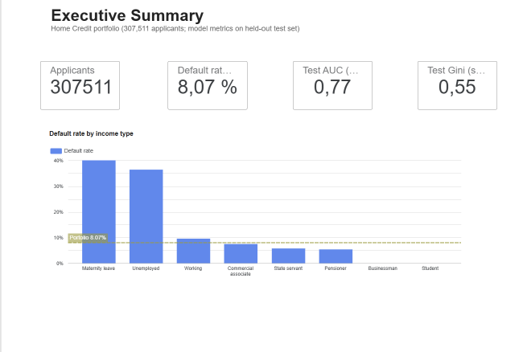
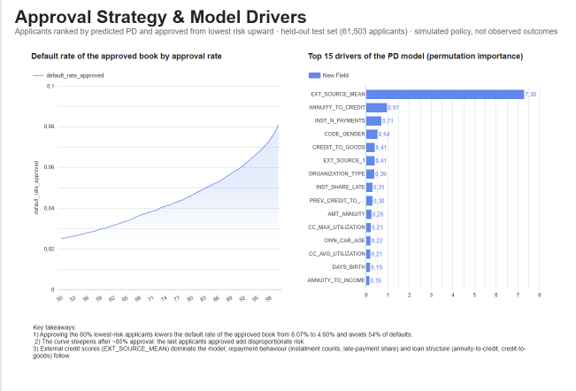
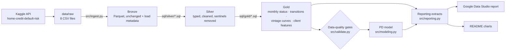
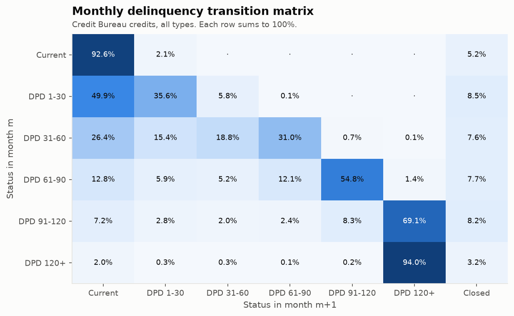
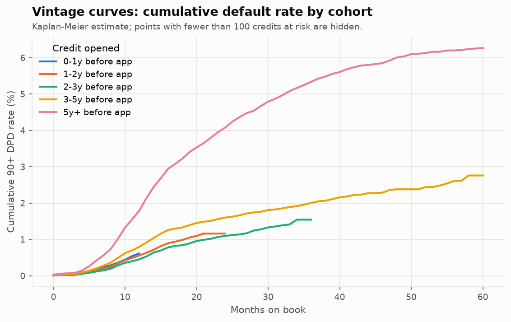
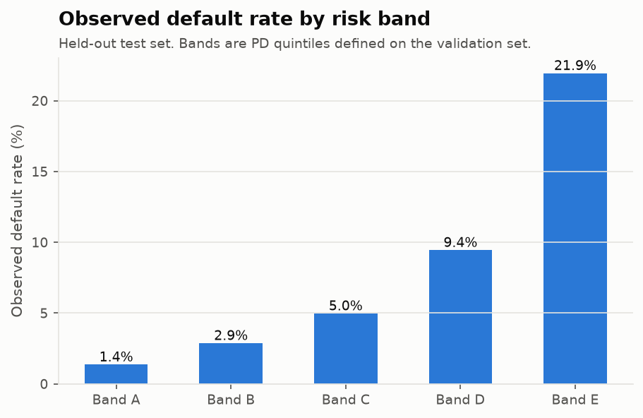
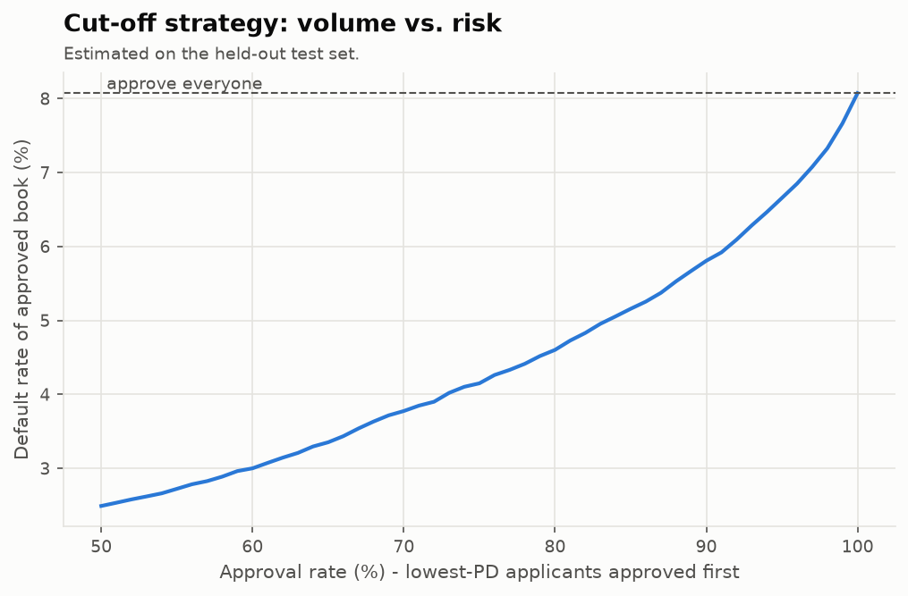
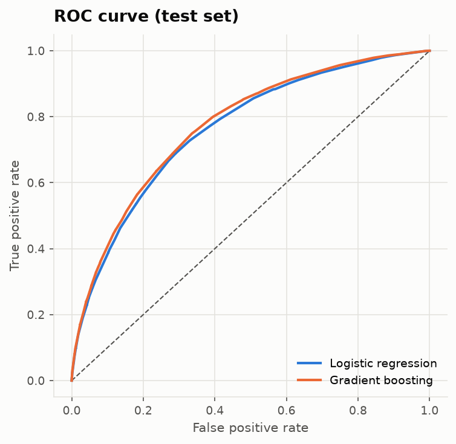
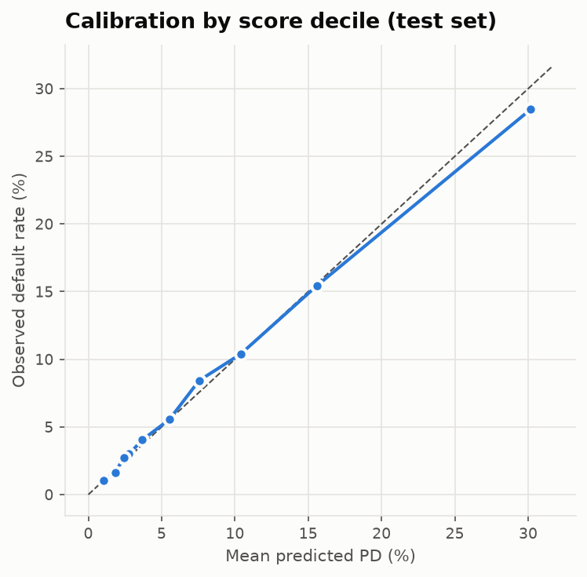
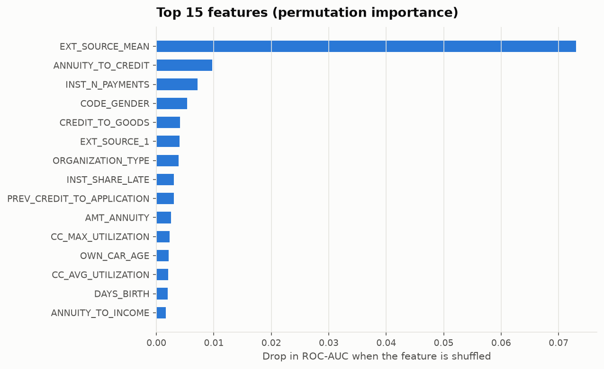

# Credit Risk & Delinquency Analytics

**End-to-end credit risk analytics on 300K+ loan applicants: delinquency transition matrices, vintage cohorts, risk segmentation and a calibrated probability-of-default (PD) model, delivered as a reproducible DuckDB pipeline and a Google Data Studio report.**


> 📊 **Live report:** [Credit Risk & Delinquency Analytics — Google Data Studio](https://datastudio.google.com/reporting/10911058-bc14-4835-a65a-9f6e37476f98) · [PDF](reports/data_studio/credit_risk_report.pdf)
> 📄 **Results of the latest run:** [`reports/results_summary.md`](reports/results_summary.md)

<p align="center">
  
  
</p>

---

## 1. Project Overview

A consumer lender needs to answer three questions every month: **how is delinquency evolving, which customers will default, and where should the approval cut-off be?** This project answers them on the public [Home Credit Default Risk](https://www.kaggle.com/competitions/home-credit-default-risk) dataset, with the same workflow used in a collections / credit-risk analytics team:

`Kaggle API → Bronze → Silver → Gold (DuckDB + Parquet) → data-quality gates → PD model → Data Studio report`

## 2. Business Problem

- **Collections:** which delinquency buckets roll forward fastest, and where does early intervention pay off?
- **Portfolio monitoring:** do newer credit cohorts deteriorate faster than older ones?
- **Underwriting:** can applicants be ranked by risk so the lender approves more good customers and fewer defaults?

## 3. Objectives

1. Build a reproducible, tested data pipeline over 58M raw records (7 tables).
2. Define default explicitly and measure **month-over-month delinquency transitions** and **roll rates**.
3. Estimate **vintage curves** (cumulative 90+ DPD by months on book) that correctly handle credits observed for different lengths of time.
4. Train and compare a **PD model** (logistic-regression baseline vs. gradient boosting), calibrated and evaluated with credit-risk metrics.
5. Translate the model into **risk bands** and an **approval cut-off strategy**.

## 4. Dataset Description

| Table | Grain | Used for |
|---|---|---|
| `application_train` | one row per applicant (307,511), with `TARGET` | PD model, segmentation |
| `bureau` | previous credits at other institutions | features, credit type |
| `bureau_balance` | credit × month status (~27M rows) | **transition matrices, vintage curves** |
| `previous_application` | previous Home Credit applications | features |
| `installments_payments` | installment-level repayments | features (days late, underpayment) |
| `POS_CASH_balance`, `credit_card_balance` | monthly snapshots | features (DPD, utilisation) |

**Default definitions**
- *Application level* — `TARGET = 1`: the client had payment difficulties (late payment on at least one of the first installments), as defined by Home Credit.
- *Credit level (bureau)* — a credit **defaults when it first reaches 90+ days past due** (`STATUS` 4 = 91–120 DPD or 5 = 120+ DPD / written off), consistent with the Basel definition. Configurable in [`config/settings.yaml`](config/settings.yaml).

The data is downloaded from Kaggle by the pipeline and is **not redistributed** in this repository (competition rules). See [`data/README.md`](data/README.md).

## 5. Tools & Technologies

| Area | Tools |
|---|---|
| Data engineering | Python, DuckDB SQL, Parquet (ZSTD), Medallion architecture, Kaggle API |
| Analytics | pandas, NumPy, survival-style (Kaplan–Meier) vintage analysis |
| Machine learning | scikit-learn: Logistic Regression, HistGradientBoosting, isotonic calibration, permutation importance |
| Reporting | Google Data Studio, matplotlib |
| Engineering | pytest, GitHub Actions CI, YAML configuration, data-quality gates |

## 6. Methodology

**Delinquency transitions.** For every open bureau credit, the status in month *m* is paired with the status in month *m+1*, giving a transition matrix by credit type (each row sums to 100%) and roll rates: % that roll forward, stay, improve or close.

**Vintage curves.** Each credit is placed on a *months-on-book* axis and grouped by when it was opened relative to the application. Credits are observed for different lengths of time, so a naive "defaults / credits" ratio is biased. The curves use a **Kaplan–Meier estimator** instead: `hazard(k) = defaults at k / credits at risk at k`, `cumulative PD(k) = 1 − ∏(1 − hazard)`. Late entry (left truncation) and censoring are handled explicitly.

**PD model.**
- ~160 features: application data, engineered ratios (credit/income, annuity/income, age, employment length) and aggregates of bureau, monthly-status, installment, POS and credit-card history.
- Stratified **train / validation / test = 64 / 16 / 20**. All preprocessing is fitted on train only. No class re-weighting, so outputs stay interpretable as probabilities.
- Logistic regression (quantile-normalised numerics, one-hot categoricals) vs. HistGradientBoosting (native missing values and categoricals); the model with the highest **validation** AUC is selected.
- **Isotonic calibration** on the validation set; the **test set is touched only once** for final metrics.
- Metrics: ROC-AUC, Gini, KS, PR-AUC, Brier score, calibration by decile, lift.

**Strategy.** Applicants are split into five risk bands (A–E, score quintiles on validation). An approval curve shows the default rate of the approved book for every approval rate from 50% to 100%.

## 7. Architecture



```
credit-risk-delinquency-analytics/
├── config/settings.yaml          # paths, default definition, model parameters
├── sql/
│   ├── silver/                   # 7 cleaning queries (one per source table)
│   └── gold/                     # monthly status, transitions, vintage curves, features
├── src/
│   ├── download.py               # Kaggle API download + unzip
│   ├── ingest.py                 # CSV -> Bronze Parquet
│   ├── transform.py              # runs the SQL layers in DuckDB
│   ├── validate.py               # data-quality gates (pipeline stops on failure)
│   ├── modeling.py               # PD models, calibration, risk bands
│   ├── evaluation.py             # AUC, Gini, KS, Brier, deciles, cut-off strategy
│   ├── reporting.py              # Data Studio CSV extracts + results summary
│   ├── visualize.py              # README charts
│   └── pipeline.py               # orchestration (CLI)
├── notebooks/                    # analysis narrative on top of the Gold layer
├── tests/                        # pytest: business rules, layers, model utilities
├── reports/
│   ├── results_summary.md        # generated by the pipeline
│   └── data_studio/              # report guide + CSV extracts
└── images/                       # generated charts
```

## 8. Key Findings

> All figures come from [`reports/results_summary.md`](reports/results_summary.md), generated by the pipeline from the Kaggle data (307,511 applicants, 58M raw records). Model and strategy figures are measured on a **held-out test set of 61,503 applicants**; strategy figures are estimates on historical data, not realised business results.

| | |
|---|---|
|  |  |
|  |  |

**1. Delinquency accelerates sharply after 30 days past due.**
Only 5.9% of credits in *DPD 1-30* roll to a worse bucket the next month, and 49.9% return to current. From *DPD 31-60* the roll-forward rate jumps to 31.8%, then to 56.3% (*61-90*) and 69.1% (*91-120*), while the cure rate falls from 49.9% to 14.4%. Once a credit reaches *120+*, 94.0% stay there the following month.

| From state | Roll forward | Stay | Improve | Closed |
|---|---|---|---|---|
| Current | 2.2% | 92.6% | 0.0% | 5.2% |
| DPD 1-30 | 5.9% | 35.6% | 49.9% | 8.5% |
| DPD 31-60 | 31.8% | 18.8% | 41.8% | 7.6% |
| DPD 61-90 | 56.3% | 12.1% | 23.9% | 7.7% |
| DPD 91-120 | 69.1% | 8.3% | 14.4% | 8.2% |

**2. The oldest cohort deteriorates fastest.**
Credits opened 5+ years before the application reach a cumulative 90+ DPD rate of 4.08% at 24 months on book, versus 1.10%–1.60% for the cohorts opened 1–5 years before. The cohorts are relative to the application date (the data has no calendar dates), so this points to a difference between credit generations, not to a specific period.

**3. The PD model ranks risk consistently and holds up out of sample.**
Gradient boosting was selected on validation AUC (0.780) and reached **AUC 0.774, Gini 0.548 and KS 0.413** on the test set. The validation-to-test gap is small, so there is no sign of overfitting. The logistic-regression baseline is close behind (test AUC 0.763), a relevant trade-off where explainability is required.

| Model (test set) | AUC | Gini | KS | PR-AUC | Brier |
|---|---|---|---|---|---|
| Logistic regression | 0.763 | 0.525 | 0.398 | 0.238 | 0.0677 |
| **Gradient boosting (selected)** | **0.774** | **0.548** | **0.413** | **0.250** | **0.0670** |

**4. Risk bands separate customers by a factor of 16.**
The observed default rate rises monotonically from **1.36% in band A to 21.95% in band E** (portfolio average 8.07%). Band E alone (20% of applicants) holds about 54% of all defaults in the test set.

**5. The cut-off is a volume-vs-risk decision with a clear curve.**

| Approval rate | Default rate of approved book | Share of defaults avoided |
|---|---|---|
| 100% (approve all) | 8.07% | 0.0% |
| 90% | 5.81% | 35.3% |
| 80% | 4.60% | 54.4% |
| 70% | 3.77% | 67.3% |

Declining the riskiest 20% of applicants lowers the default rate of the approved book from 8.07% to 4.60% (−43% relative) and avoids 54.4% of defaults.

<details>
<summary>Model diagnostics</summary>

| | |
|---|---|
|  |  |


</details>

## 9. Business Recommendations

These recommendations follow from the results above. Before acting on them, a lender would validate them against its own portfolio, margins and loss data.

1. **Concentrate early collections effort before day 30.** The roll-forward rate is five times higher in *DPD 31-60* (31.8%) than in *DPD 1-30* (5.9%), and half of the 1-30 bucket still cures. Reminders, payment-date changes and contact campaigns are likely to have the highest return in the first 30 days.
2. **Escalate at 61-90 DPD.** With 56.3% of these credits rolling forward and only 23.9% improving, this is the last bucket where restructuring or settlement offers can realistically change the outcome.
3. **Route band E to manual review or decline.** Band E carries a 21.95% default rate, 2.7 times the portfolio average. Bands A–B (1.4%–2.9%) are candidates for faster or automated approval.
4. **Choose the approval cut-off with profitability data.** The cut-off table shows the risk side only. The right point (for example 80% vs. 90% approval) depends on interest margin and loss given default, which this dataset does not include. The Data Studio report lets you compare cut-offs interactively.
5. **Monitor portfolios by vintage.** The older-cohort result shows that deterioration differs between credit generations; vintage curves should be tracked as part of regular portfolio reviews.
6. **Model choice depends on the governance context.** Gradient boosting is 0.011 AUC points better; logistic regression is easier to explain to regulators and customers. Both are calibrated, so either can be used for pricing or limits.

## 10. How to Run

**Prerequisites:** Python 3.11+, ~6 GB of free disk, a Kaggle account.

1. **Accept the competition rules** at https://www.kaggle.com/competitions/home-credit-default-risk/rules (otherwise the API returns 403).
2. **Create a Kaggle API token:** kaggle.com → *Settings* → *API* → *Create New Token*. Save `kaggle.json` in `~/.kaggle/` (Windows: `C:\Users\<you>\.kaggle\`). Never commit it.
3. **Install and run:**

```bash
git clone https://github.com/Raul9915/credit-risk-delinquency-analytics.git
cd credit-risk-delinquency-analytics
python -m venv .venv
source .venv/bin/activate          # Windows: .venv\Scripts\activate
pip install -r requirements.txt

python -m src.pipeline             # download -> bronze -> silver/gold -> checks -> model -> reports
pytest -q                          # tests (no Kaggle data needed)
```

Useful options: `--skip-download` (use files already in `data/raw`), `--until gold` (stop after the data layers).

Outputs: `data/{bronze,silver,gold}/*.parquet`, `reports/results_summary.md`, `reports/metrics.json`, `reports/data_studio/data/*.csv`, `images/*.png`.

## 11. Limitations & Next Steps

**Limitations**
- **No calendar dates.** All dates are relative to the application, so cohorts are relative ("opened 2–3 years before application") and an out-of-time validation is not possible; a stratified random split is used instead.
- `bureau_balance` covers only part of the bureau credits; applicants without history rely on application data.
- `TARGET` is Home Credit's own definition of payment difficulty, not a 90+ DPD default; the two definitions are analysed separately.
- Single lender in emerging markets: results do not transfer directly to other portfolios.
- `CODE_GENDER` ranks among the top drivers. It is kept for analysis only; a production credit model would exclude protected attributes and be tested for fair-lending bias.

**Next steps**
- Weight-of-evidence scorecard for a fully explainable model.
- Expected-loss view (PD × LGD × EAD) with assumed LGD scenarios.
- Fairness check of approval rates across demographic groups.

---

**Author:** Raul Mendoza Sotomayor · [LinkedIn](https://www.linkedin.com/in/raul-mendoza-sotomayor) · [GitHub](https://github.com/Raul9915)

Data: Home Credit Default Risk (Kaggle). Code: MIT License.
